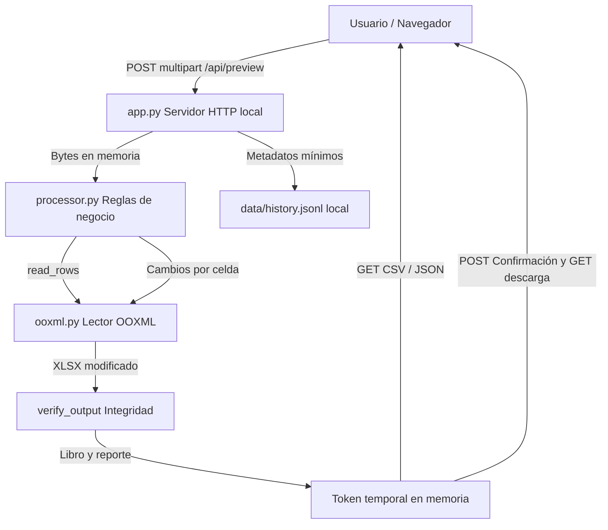

# Arquitectura técnica

## Propósito

Se carga una plantilla Falabella y varios archivos fuente, se cruzan por SKU y se escriben **únicamente celdas autorizadas** en la hoja «Subir plantilla». El resultado conserva el contenido binario de cada parte interna OOXML externa a la hoja editada y valida los cambios dentro de ella.

## Separación de responsabilidades

| Módulo | Responsabilidad |
|---|---|
| `app.py` | HTTP local, límites de carga, previsualización, aprobación, descargas, historial corto |
| `processor.py` | Mapeo configurable, normalización de búsqueda, cruces SKU, reglas comerciales, validación y reporte |
| `ooxml.py` | Lectura XML de XLSX, parche de celdas XML, seguridad ZIP y conservación de libro |
| `templates/index.html`, `static/` | Carga de documentos, opciones, vista previa por fila, advertencias, exportación |
| `tests/` | Fixtures sintéticas, pruebas de regresión API/OOXML/seguridad, sin datos reales |

## Flujo de procesamiento

1. El servidor valida tamaño, campos, extensión y origen local de la petición.
2. `safe_xlsx` comprueba ZIP, nombres únicos de partes, rutas canónicas, máximos de expansión y ausencia de VBA.
3. Se reconocen hojas y encabezados; se rechazan coincidencias alternativas ambiguas.
4. Los productos de Responsables se indexan por una **clave de comparación** normalizada. El SKU comercial se escribe **tal como venía**, sin modificar guiones/barras de manera silenciosa.
5. Precios y fotos se buscan mediante reglas de precedencia, con prioridad a datos explícitos y bloqueo de contradicciones.
6. El motor de escritura cambia solo valores XML de las celdas previstas.
7. `verify_output` comprueba la igualdad de partes protegidas, XML exterior a filas/celdas editadas, estilos y ZIP válido.
8. El usuario revisa reporte/errores y confirma si desea un archivo para revisión final o un borrador marcado NO PUBLICAR.

## Integridad: alcance exacto

Se conserva **el contenido descomprimido** de cada miembro del ZIP excepto la hoja de salida. El contenedor ZIP de destino puede tener diferencias de compresión y metadatos ZIP al reescribirse; por eso no se promete igualdad bit a bit del archivo completo. La hoja modificada solo permite cambios en celdas incluidas en el plan. No se comprueba la aceptación de requisitos particulares del catálogo Seller Center.

## Decisiones de diseño

- Servidor en `127.0.0.1` y estándar Python, sin API remota ni credenciales.
- Sin base de datos: un historial mínimo `data/history.jsonl` es suficiente en el prototipo.
- Sin filas nuevas: se exige que las filas estén preparadas y la plantilla preserve sus validaciones.
- Sin cálculo automático de fórmulas Excel que no tienen caché calculada.
- Identificadores EAN-13 se **validan**, pero no se generan para fines comerciales ni se comprueba registro GS1.

## Riesgos conocidos

Los vendedores pueden cambiar plantilla, categorías, atributos o esquema de Seller Center sin aviso; la configuración JSON puede ayudar con encabezados pero no sustituye una prueba piloto real. La compilación del EXE y la automatización Excel COM requieren verificación en Windows.
